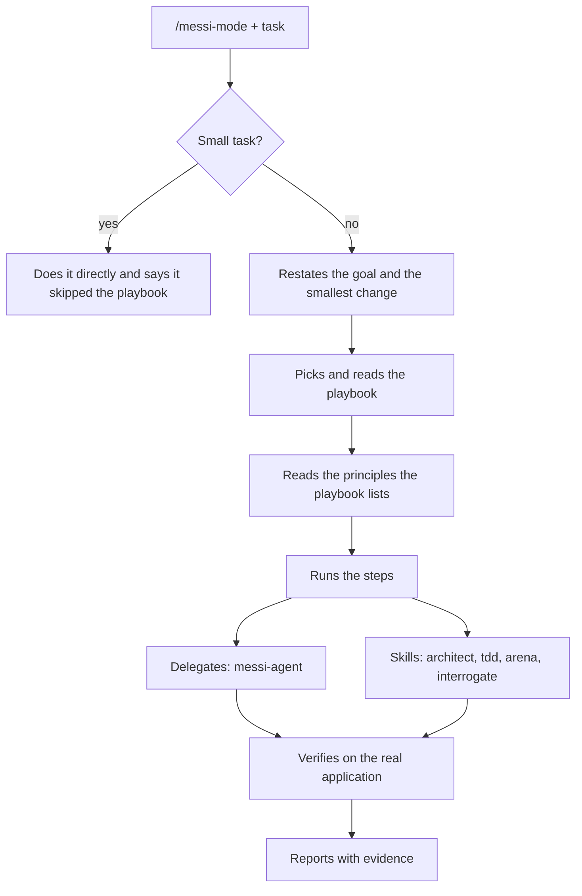

# messi-stack

A personal Claude Code setup for engineering work that has to be right. It is an adaptation of [pstack](https://github.com/cursor/plugins/tree/main/pstack), the skill stack that poteto (Lauren Tan) uses in Cursor.

You type `/messi-mode` before a task. The mode picks a playbook for the task, reads the principles that the playbook lists, delegates to subagents, and verifies the result on the real application before it reports.

## What is in it

| Part | Count | Where |
|---|---|---|
| The mode | 1 skill | `skills/messi-mode/SKILL.md` |
| Playbooks | 19 | `skills/messi-mode/playbooks/` |
| Principles | 24 | `skills/messi-mode/principles/` |
| Standalone skills | 28 | `skills/<name>/SKILL.md` |
| Agents | 2 | `agents/messi-agent.md`, `agents/comment-sicko.md` |

To recount, run `python3 tools/check.py .` from the repository root.

## Install

You need [Claude Code](https://claude.com/claude-code). The GPT review seats also need the [Codex CLI](https://github.com/openai/codex), signed in.

```sh
git clone https://github.com/fedelombar/messi-stack
cd messi-stack
./install.sh
```

`install.sh` copies `skills/` and `agents/` into `~/.claude`. It skips any skill or agent of yours that has the same name and different content, and it lists what it skipped. To replace those, run `./install.sh --force`.

Start a new Claude Code session after you install. A session that was already open does not see the new skills.

## Use

Type `/messi-mode` and describe the task the way you would describe it to a colleague.

```text
/messi-mode the scheduled send fails for Brazilian numbers. reproduce it first, then fix and verify.
```

```text
/messi-mode add a --json flag to this command. text output stays byte-identical. verify both.
```

```text
/messi-mode how does the backend decide which chats are shared? read-only.
```

These phrases change what the mode does:

| You say | The mode does |
|---|---|
| "open the PR at the end" | Pushes and opens a pull request. Without this phrase, the mode stops at local commits and offers the pull request. |
| "use Fable" | Runs the code-writing agents on Fable. The default is Opus. |
| "don't stop" or "going to bed" | Continues without questions on reversible work. The pause list below still applies. |
| "read-only" | Changes no code. |

The mode stays in context for the whole session. For a question, a one-line edit, or a contained change to one file, the mode skips the playbook and says so. To work with no mode at all, use a session where you did not type `/messi-mode`.

You can also call each standalone skill without the mode, for example `/how`, `/why`, `/interrogate`, or `/unslop`.

## How a run works



## Playbooks

| Playbook | Use it for |
|---|---|
| Investigation | A read-only question about how or why something works |
| Bug fix | Reproduce, find the root cause, fix with runtime evidence |
| Feature | New behavior, built from a named data shape |
| Refactoring | A change to structure that keeps behavior the same |
| Prototype | A throwaway sketch that settles a design choice |
| Perf issue | Measure a slowness and improve it against a baseline |
| Hillclimb | Improve one metric in a loop, one commit for each accepted gain |
| Runtime forensics | Diagnose a live process |
| Trace forensics | Diagnose from a captured profile or trace |
| Visual parity | Pixel-exact match between two implementations |
| Multi-phase plan | A plan of several pull requests with dependencies |
| Autonomous run | A long task that runs to a checkable exit condition |
| Session pickup | Resume the work of an earlier session |
| Pause safely | Stop cleanly and leave a resume note |
| Babysit | Bring a pull request to merge-ready. It never merges. |
| Worktree cleanup | Reclaim disk from old worktrees, with safety gates |
| Eval | Test blind whether a skill change improves the agent |
| Authoring a skill | Write or edit a skill |
| Opening a PR | Open the pull request, only when you asked for one |

## Standalone skills

| Group | Skills |
|---|---|
| Understand | `how`, `why`, `teach`, `recall`, `ketchup`, `bro`, `in-your-own-words`, `sharpen` |
| Design | `architect`, `arena`, `blast-radius`, `figure-it-out` |
| Build and clean | `tdd`, `swarm`, `no-comments`, `unslop`, `technical-writing`, `typescript-best-practices` |
| Verify | `interrogate`, `benchmark-checklist`, `show-me-your-work`, `create-verification-skill`, `maintain-verification-skill`, `create-formal-verification-skill`, `maintain-formal-verification-skill`, `statechart` |
| Learn | `reflect`, `correct` |

Each skill states its purpose in the `description` line of its `SKILL.md`.

## What differs from pstack

`skills/messi-mode/UPSTREAM.md` lists the source commit and every change. These are the changes that affect behavior.

**The agent pauses before risky actions.** poteto-mode lets external actions proceed without a question. messi-mode asks first before any of these:

- A change to production: a database write, a deploy, a release, a feature flag, a cluster write.
- A message to a person: chat, email, a customer, a comment on someone else's pull request.
- A write to an outside system that you did not ask for in this task.
- A force-push, a merge, deleted data, or a deleted branch that the session did not create.
- A push or a pull request that you did not ask for.

**The repository wins.** When the repository has its own rule or skill on a topic, the agent follows that one.

**Git rules travel with the delegates.** The agent never commits on the default branch, adds no `Co-Authored-By` trailer and no AI footer, pushes with an explicit refspec, and checks the base branch of the pull request. `skills/messi-mode/worker.md` repeats these rules, because a subagent sees none of your memory.

**The agent delegates less.** pstack delegates implementation in most playbooks and gives each fix round to a fresh subagent. messi-mode writes small changes in the main thread, sends a fix round back to the same subagent, and runs one fresh verifier at the end. The Cost section gives the reason.

**Each playbook lists the principles to read.** As shipped, pstack tells the agent to cite only the principles it read, and the agent reads none. [cursor/plugins issue 726](https://github.com/cursor/plugins/issues/726) measured this: 0 of 72 runs read a principle file. With the list at the top of each playbook, 68 of 72 runs did. Every playbook here opens with that list.

**Cursor names are replaced in the text.** The skills name Claude Code tools directly, so no adapter document is needed at run time.

## Models and the review panel

| Role | Model |
|---|---|
| Agents that write or change code | Opus. Fable when you name it or the session runs on Fable. |
| Agents that explore, read, or run mechanical checks | Your Claude Code default |
| Review panel, seat 1 | Opus |
| Review panel, seat 2, and the `arena` judge | The newest GPT Astra model, through the Codex CLI |
| Review panel, seat 3, for large or contested changes | The newest GPT Sol model, through the Codex CLI |

A GPT seat is a shell command, not a subagent:

```sh
codex exec -m gpt-6.2-astra -s workspace-write --ephemeral \
	-c model_reasoning_effort=high \
	-C <worktree> -o <report-file> - < <brief-file>
```

If `codex` is missing or the call fails, the mode reports that seat as a dropout. The mode never fills a GPT seat with a Claude agent.

## Cost

The mode spends more tokens than a plain session. Most of the extra cost comes from subagents, not from the skill text.

- The mode file is about 3,500 tokens and stays in context for the session. A playbook and its principles add about 1,000 to 3,000 tokens.
- Each subagent starts with its own context. In the author's setup, 8 `general-purpose` agents each started at 52,000 to 53,000 tokens. That start was a cache write in most runs, so one agent does not reuse the start of another.
- After the start, most of what an agent processes is cache reads, which cost about a tenth of the input price. A read-only bug fix of 9 turns processed 640,000 tokens, and 561,000 of them were cache reads. Weighted by price, that run equals about 175,000 input tokens, and the start is about 38% of it.
- The start is therefore the cost to cut. The mode delegates only when the change touches more than three files, the work can run in parallel, or the work needs bulk reading. A fix round goes back to the same subagent and does not start a new one.

These numbers come from 10 agent runs in one session and one setup. No full playbook run that writes code has been measured. The Codex CLI runs the GPT seats, so those seats use your OpenAI account and no Claude tokens.

## Make it yours

messi-mode is one person's style. To change it:

1. Edit the hand-written files in `tools/overlay/`. `tools/overlay/skills/messi-mode/SKILL.md` holds the autonomy rules, the model rules, and the git rules.
2. Change the edits to pstack text in `tools/build.py`. Each edit is one replacement, and the build fails when the text no longer matches.
3. Rebuild and check:

```sh
git clone --depth 1 https://github.com/cursor/plugins /tmp/cursor-plugins
python3 tools/build.py /tmp/cursor-plugins/pstack tools/overlay out
python3 tools/check.py out
```

4. Compare `out/` with `skills/` and `agents/`, copy what you want, and run `./install.sh --force`.

After a long task, type `/reflect`. It proposes edits to the skills from what the session taught, and it waits for your approval. `install.sh` records the path of your clone in `~/.claude/skills/messi-mode/SOURCE`, so `reflect` makes the approved edits in the clone and not in the installed copy.

To rename the mode, rename the `messi-mode` folder and the `messi-agent` file, and replace both names in `tools/`.

## Repository layout

| Path | Contents |
|---|---|
| `skills/` | The built skills. `install.sh` copies this folder. |
| `agents/` | The built agents. |
| `tools/overlay/` | The hand-written files: the mode, the worker rules, the delegate agent, the Opening a PR playbook, and `UPSTREAM.md`. |
| `tools/build.py` | Builds `skills/` and `agents/` from a pstack checkout and the overlay. |
| `tools/check.py` | Checks that every skill, principle, and playbook that a file names exists. |
| `docs/guia.es.md` | A guide in Spanish, written as an Obsidian note. |

## What is tested

| Check | Result |
|---|---|
| Every reference between skills, principles, and playbooks | Resolves (`tools/check.py`) |
| A read-only investigation that follows the mode | Worked |
| A read-only bug fix | The agent read the playbook and its 5 principles |
| A delegate that starts from `worker.md` | Worked |
| `codex exec` with `gpt-6.2-astra` and `gpt-6.2-sol` | Both answered |
| The worktree audit script | Listed the worktrees correctly |

Not tested yet: the playbooks that write code, from start to finish. Full runs of `arena`, `swarm`, and `interrogate`. The formal verification skills and `statechart`.

No one has measured whether a mode like this one produces better code. The only measured result is that the principle files get read.

## What is left out of pstack

| Left out | Reason |
|---|---|
| The `shipping`, `autopilot-full`, and `autopilot-stack` playbooks | They merge pull requests unattended and depend on Cursor cloud agents. |
| `setup-pstack` | The model rules are in the mode file. |
| `automate-me` | It reads Cursor transcripts. |
| `poteto-help` | It is a guide to pstack. |
| `make-bot-ui`, `ketchup-video` | They need Grok Bot and a video pipeline. |

## Credits and license

pstack is the work of [poteto](https://x.com/poteto). The principles, the playbooks, and most of the skills are that work, with the edits that `skills/messi-mode/UPSTREAM.md` lists. Both pstack and messi-stack use the MIT license. See `LICENSE`.
