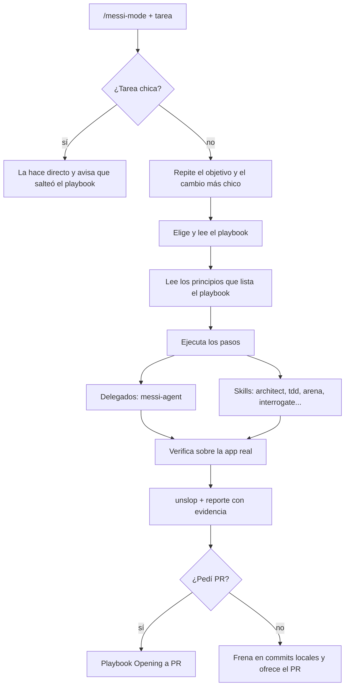

# Messi stack

Mi setup personal de Claude Code para trabajo de ingeniería con rigor. Es una adaptación de **pstack** de poteto (Lauren Tan), el stack que usa en Cursor.

> [!summary] En una línea
> Escribo `/messi-mode` al empezar una tarea. El modo elige un playbook, lee los principios que ese playbook lista, delega en subagentes y verifica sobre la app real antes de decir "listo".

## Cómo usarlo

| Situación | Qué hago |
|---|---|
| Tarea que necesita rigor (bug, feature, refactor, perf) | `/messi-mode <la tarea>` al empezar |
| Tarea chica (pregunta, una línea, un archivo) | No lo invoco. Si ya está activo en la sesión, el modo se saltea el playbook solo y lo avisa |
| Quiero un skill suelto | `/how`, `/why`, `/unslop`, `/interrogate`, etc., sin el modo |
| Sesión sin persona (tarea programada, hilo lanzado por un agente) | El prompt tiene que decir: "leé `~/.claude/skills/messi-mode/SKILL.md` y seguilo" |

> [!warning] El modo queda activo toda la sesión
> Una vez invocado, el texto de `messi-mode` queda en contexto hasta que termina la sesión. Para trabajar sin el modo, abrir una sesión nueva.

## Cómo funciona



## Dónde vive cada cosa

| Qué | Ruta |
|---|---|
| El modo | `~/.claude/skills/messi-mode/SKILL.md` |
| Principios (24) | `~/.claude/skills/messi-mode/principles/` |
| Playbooks (19) | `~/.claude/skills/messi-mode/playbooks/` |
| Reglas para subagentes | `~/.claude/skills/messi-mode/worker.md` |
| Skills globales (28) | `~/.claude/skills/<nombre>/SKILL.md` |
| Agentes | `~/.claude/agents/messi-agent.md`, `comment-sicko.md` |
| Qué cambié respecto de pstack | `~/.claude/skills/messi-mode/UPSTREAM.md` |
| Script que regenera lo copiado | `tools/build.py` en el repo messi-stack |

## Reglas propias (lo que no es de poteto)

### Autonomía

**Hace sin preguntar:** leer, editar, crear ramas, commits locales en una rama de trabajo, tests, builds, prototipos, consultas de solo lectura a logs y a dev.

**Siempre frena y pregunta antes de:**

- Cambiar producción: escrituras a la base, deploys, releases, feature flags, cluster.
- Mandarle un mensaje a una persona: WhatsApp, Slack, mail, cliente, comentario en un PR ajeno.
- Escribir en un sistema externo que no pedí: CRM, tickets, monitores, flags.
- Force-push, merge, borrar datos, borrar ramas o worktrees que no creó la sesión.
- Push o PR que no pedí.

"No pares" o "me voy a dormir" no levanta esa lista. Lo que quede pendiente se reporta al final.

### Git

- Nunca commitea en la rama por defecto.
- Sin `Co-Authored-By` y sin footer de IA en los PRs.
- Push con refspec explícito: `git push origin <rama>:<rama>`.
- Verifica la base del PR, no asume `main`.
- Código, commits, PRs y docs en inglés. La respuesta, en el idioma en que escribo.

### El repo manda

Si el repo tiene su propio skill o regla sobre el mismo tema (tipos, comentarios, texto de PR, verificación), gana el del repo.

### Modelos

| Rol | Modelo |
|---|---|
| Agentes que escriben o cambian código | Opus |
| Lo mismo, si nombro Fable o la sesión corre en Fable | Fable |
| Explorar, leer, chequeos mecánicos | Lo que diga mi configuración (hoy Sonnet) |
| Panel de review, asiento 1 | Opus (Fable si lo nombro o la sesión corre en Fable) |
| Panel de review, asiento 2 y juez | GPT Astra más nuevo (hoy `gpt-6.2-astra`), por `codex exec` |
| Panel de review, asiento 3, solo en cambios grandes | GPT Sol más nuevo (hoy `gpt-6.2-sol`), por `codex exec` |

### Cómo corre el asiento GPT

El asiento GPT no es un subagente. Es la CLI de Codex corrida como comando de terminal, con mi sesión de ChatGPT:

```sh
codex exec -m gpt-6.2-astra -s workspace-write --ephemeral \
  -c model_reasoning_effort=high \
  -C <carpeta> -o <reporte.md> - < <pedido.md>
```

| Parte | Qué hace |
|---|---|
| `codex exec` | Corre Codex sin interfaz: recibe un pedido, trabaja y termina |
| `-m` | El modelo. Astra más nuevo para el asiento 2 y el juez, Sol más nuevo para el asiento 3 |
| `-s` | `read-only` para el juez, `workspace-write` para un revisor que escribe y corre un repro |
| `--ephemeral` | No guarda la sesión en el historial de Codex |
| `-C` | Carpeta de trabajo: una copia aparte del repo (worktree) |
| `-o` | Archivo donde deja la respuesta final |

Flujo de un `/interrogate`:

1. Claude escribe el pedido en un archivo.
2. Lanza en paralelo un subagente Opus y el comando de Codex, cada uno en su copia del repo.
3. Lee los dos reportes.
4. Vuelve a correr cada comando que dicen que falla. Solo queda lo que se reproduce.

> [!warning] Los agentes `ocx-*` no son GPT sin el proxy
> Los `ocx-*` solo llegan a GPT si el proxy de opencodex está corriendo (`ocx status`). Con el proxy apagado corren en Claude y dicen ser GPT igual. Por eso no se usan como asiento GPT.

- Gasta la cuota de Codex de mi suscripción de ChatGPT, no la de Claude.
- Si `codex` falla, el asiento se reporta como caído. Nunca se reemplaza por un agente Claude.
- La lista de modelos disponibles está en `~/.codex/models_cache.json`.

## Playbooks

| Playbook | Para qué |
|---|---|
| Investigation | Pregunta de solo lectura: cómo funciona algo, por qué, si estamos seguros |
| Bug fix | Reproducir, encontrar la causa raíz, arreglar con evidencia. Test que falla antes del fix |
| Feature | Comportamiento nuevo, diseñado desde la forma de los datos |
| Refactoring | Cambiar la estructura sin cambiar el comportamiento |
| Prototype | Boceto descartable para decidir un diseño barato |
| Perf issue | Medir una lentitud y mejorarla contra una línea de base |
| Hillclimb | Mejorar una métrica en loop, un commit por mejora aceptada |
| Runtime forensics | Diagnosticar un proceso vivo (leak, CPU, glitch) |
| Trace forensics | Diagnosticar desde un perfil o trace ya capturado |
| Visual parity | Igualdad pixel a pixel entre dos implementaciones |
| Multi-phase plan | Plan de varios PRs con dependencias. No implementa |
| Autonomous run | Tarea larga sin parar, con condición de salida verificable |
| Session pickup | Retomar el trabajo de otra sesión sin rehacerlo |
| Pause safely | Frenar limpio y dejar una nota para retomar |
| Babysit | Llevar un PR a listo para merge. Nunca mergea |
| Worktree cleanup | Recuperar disco borrando worktrees viejos, con controles |
| Eval | Probar a ciegas si un cambio de skill mejora al agente |
| Authoring a skill | Escribir o editar un skill |
| Opening a PR | Abrir el PR. Solo cuando lo pedí |

## Skills

### Entender

| Skill | Para qué |
|---|---|
| `/how` | Cómo funciona un subsistema |
| `/why` | Por qué se construyó así, desde commits y PRs |
| `/teach` | Explicación a fondo de un cambio, con diagramas |
| `/recall` | Reconstruir mi contexto reciente sobre un tema |
| `/ketchup` | Qué cambió en este chat desde mi último mensaje |
| `/bro` | El último mensaje en lenguaje llano |
| `/in-your-own-words` | Que repita mi objetivo antes de empezar |
| `/sharpen` | Mejorar un prompt antes de mandarlo |

### Diseñar

| Skill | Para qué |
|---|---|
| `/architect` | Tipos, firmas y módulos antes de escribir código |
| `/arena` | Varios intentos en paralelo de lo mismo, y quedarse con lo mejor |
| `/blast-radius` | Qué más puede romper un cambio que parece chico |
| `/figure-it-out` | Diseñar un playbook cuando ninguno encaja |

### Construir y limpiar

| Skill | Para qué |
|---|---|
| `/tdd` | Test que falla primero, después el fix |
| `/swarm` | Varios agentes en paralelo sobre partes distintas, un solo reporte |
| `/no-comments` | Sacar comentarios que sobran (agente Comment Sicko) |
| `/unslop` | Sacar el tono de IA de un texto |
| `/technical-writing` | Estándar para docs, PRs y commits |
| `/typescript-best-practices` | Disciplina de tipos en TypeScript |

### Verificar

| Skill | Para qué |
|---|---|
| `/interrogate` | Revisores de distintos modelos intentan romper un cambio. Solo queda lo probado |
| `/benchmark-checklist` | Validar un número medido antes de confiar en él |
| `/show-me-your-work` | Registro de decisiones para revisar después |
| `/create-verification-skill` | Generar un skill del repo que prueba la app de verdad |
| `/maintain-verification-skill` | Actualizar ese skill cuando la app cambió |
| `/create-formal-verification-skill` | Verificar una propiedad (carreras, reintentos, máquinas de estado) |
| `/maintain-formal-verification-skill` | Mantener esa verificación |
| `/statechart` | Dibujar un modelo TLA+ como diagrama de estados |

### Aprender

| Skill | Para qué |
|---|---|
| `/reflect` | Convertir lo aprendido en una sesión en cambios a un skill. Pide aprobación |
| `/correct` | Convertir un error repetido en un tipo, lint o test del repo |

## Principios

Cada playbook lista al principio los principios que el agente tiene que leer.

**Núcleo**

| Principio | Idea |
|---|---|
| laziness-protocol | El cambio más chico que resuelve el problema. Preferir borrar |
| foundational-thinking | Primero los tipos y estructuras de datos |
| redesign-from-first-principles | Rediseñar como si el requisito hubiera estado desde el día uno |
| attack-the-premise | Si dos arreglos con la misma premisa fallaron, probar la premisa |
| subtract-before-you-add | Sacar lo muerto antes de agregar |
| minimize-reader-load | Menos capas y menos estado que el lector tenga que recordar |
| outcome-oriented-execution | En migraciones, ir a la arquitectura final sin estados intermedios descartables |
| experience-first | La experiencia del usuario antes que la comodidad de implementar |
| exhaust-the-design-space | 2 o 3 prototipos antes de decidir algo sin precedente |
| build-the-lever | Construir la herramienta que hace o prueba el trabajo |

**Arquitectura**

| Principio | Idea |
|---|---|
| model-the-domain | Una estructura en vez de condicionales sueltos |
| boundary-discipline | Validar en los bordes, confiar adentro |
| type-system-discipline | Que los estados ilegales no se puedan representar |
| make-operations-idempotent | Mismo resultado aunque se corra dos veces o a medias |
| migrate-callers-then-delete-legacy-apis | Migrar y borrar la API vieja en la misma tanda |
| separate-before-serializing-shared-state | Eliminar lo compartido antes de serializar el acceso |

**Verificación**

| Principio | Idea |
|---|---|
| prove-it-works | Verificar sobre el artefacto real, no "compila" |
| fix-root-causes | Arreglar donde el sistema se equivocó primero |
| sequence-verifiable-units | Unidades chicas, cada una con su chequeo |
| test-behavior-not-implementation | Testear lo que el usuario del código puede observar |
| explain-the-number | Antes de confiar en un número, saber qué lo limita |

**Delegación y meta**

| Principio | Idea |
|---|---|
| guard-the-context-window | Lo voluminoso va a subagentes |
| never-block-on-the-human | En trabajo reversible, avanzar y mostrar |
| encode-lessons-in-structure | La segunda vez que repito una instrucción, convertirla en lint o script |

## Qué dejé afuera de pstack

| Qué | Por qué |
|---|---|
| shipping, autopilot-full, autopilot-stack | Mergean solos y dependen de agentes en la nube de Cursor |
| setup-pstack | Los modelos por rol ya están en `messi-mode` |
| automate-me | Lee transcripts de Cursor. Adaptable, pendiente |
| poteto-help | Es una guía de pstack |
| make-bot-ui, ketchup-video | Necesitan Grok Bot y un pipeline de video |

## Qué está probado y qué no

| Probado | Resultado |
|---|---|
| Todas las referencias entre skills, principios y playbooks | Resuelven (chequeo automático) |
| Investigación de solo lectura siguiendo el modo | Funcionó |
| Bug fix de solo lectura | Leyó el playbook y sus 5 principios |
| Delegado con `worker.md` | Funcionó |
| `codex exec` con `gpt-6.2-astra` y `gpt-6.2-sol` | Responden |
| Agentes `ocx-*` sin el proxy de opencodex | Corren en Claude aunque digan ser GPT. No se usan |
| Modelo explícito le gana a la variable de Sonnet | Sí |
| Script de worktree-cleanup en modo auditoría | Lista bien los worktrees |

> [!todo] Sin probar
> - `/messi-mode` escrito por mí en una sesión nueva.
> - Playbooks que escriben código, de punta a punta.
> - `/arena`, `/swarm` e `/interrogate` completos, con el asiento GPT escribiendo un repro.
> - Si `high` es el nivel de razonamiento correcto para revisar.
> - La regla "código con Opus, o Fable si lo nombro".
> - Los skills de verificación formal y `/statechart`.

## Lo que aprendí de otros ports

- El port oficial de pstack a Claude Code tiene un defecto medido: tal como viene, 0 de 72 corridas leyeron un principio. Con la lista de principios al principio de cada playbook, 68 de 72. Por eso mis playbooks abren con esa lista. Fuente: cursor/plugins issue 726.
- Los ports principales a Claude Code revisan solo con modelos Claude. Yo tengo asiento GPT por `codex exec`.
- Un paper de julio de 2026 (arXiv 2607.21656, solo leí el abstract) midió que Claude revisando borradores de Codex sube el acierto de 71.6% a 89.7%, y Codex revisando borradores de Claude lo baja de 91.4% a 82.8%. Por eso GPT busca fallas y la decisión final queda en Claude.
- Nadie midió si el modo mejora el resultado. Solo está medido que los principios se leen.
- `nicksalt/skills` descartó el modo y los principios y se quedó con unos 30 skills. Es la postura contraria a la mía.

## Para analizar

Preguntas para revisar después de dos semanas de uso:

- [ ] ¿En qué tareas lo invoqué y en cuáles no? ¿Acerté?
- [ ] ¿Qué playbooks usé de verdad? ¿Cuáles nunca?
- [ ] ¿Qué skills sueltos usé? ¿Cuáles sobran en el menú?
- [ ] ¿Frenó de más o de menos con las reglas de autonomía?
- [ ] ¿Cuántos tokens gasta una tarea con el modo contra una sin el modo?
- [ ] ¿El panel con GPT encontró algo que Claude no?
- [ ] ¿Los delegados en Opus valen el costo frente a Sonnet?
- [ ] ¿Qué corregí a mano más de una vez? Eso va a `/reflect` o `/correct`.

## Cómo actualizar desde pstack

1. Clonar `cursor/plugins`.
2. Desde el repo messi-stack: `python3 tools/build.py <clon>/pstack tools/overlay out`.
3. Si poteto cambió un texto editado, el script falla y dice dónde.
4. Comparar `out/` con `skills/` y `agents/` antes de copiar.

El detalle está en `skills/messi-mode/UPSTREAM.md`.
